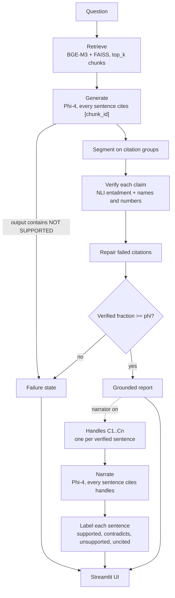

# Architecture

SEAR answers a question in two strictly ordered passes. The **answer path** retrieves chunks, has a frozen local model answer with a citation on every sentence, checks each claim against the chunks it cites, and either emits a grounded report or the failure state. The optional **narrator path** then summarises that finished report for a non-specialist and checks every summary sentence against the report, never against the corpus. Nothing in the second pass can change the first.

Setup, commands and configuration are in the [README](../README.md). This document covers how the pieces fit, the exact rules each check applies, and why each rule exists.

## Invariants

These hold everywhere in the code, and most of the design follows from them.

1. **The report is final before narration.** `Sear.answer()` returns a complete `Report`; `Sear.narrate()` only reads it. The UI caches both per question, so turning the narrator on or off never regenerates the answer.
2. **Supported means a check passed on the cited evidence.** A claim is verified against the chunks it cites, and a summary sentence against the report sentences it cites. Nothing is marked supported by association.
3. **Failure is an output.** "The corpus does not support an answer to this question" is a normal result with its own metrics, not an exception path.
4. **Each layer sees less than the one before.** The generator sees only the retrieved chunks. The narrator sees only the verified sentences, under handles, with no chunk IDs and no corpus.
5. **Every check has a probe or control that fails if the check stops working.** Probes test the behaviour on realistic questions; the seeded controls test that the checks fire on a known slip.

## Data flow

## Components

| Module | Responsibility | Runs on |
|---|---|---|
| `pipeline.py` | `Sear`: loads the models once and wires the stages. `answer()` runs the answer path, `narrate()` the narrator path, `ask()` both | |
| `retrieve.py` | `Retriever`: BGE-M3 embeddings, FAISS flat inner-product index (cosine on normalised vectors) | CPU |
| `prompts.py` | `GENERATE` and `NARRATE` prompts; `format_sources` and `format_report`, which decide exactly what each model sees | |
| `generate.py` | `Generator`: Hugging Face causal LM, NF4 4-bit, chat template, greedy decoding, whole model on GPU 0 | GPU |
| `segment.py` | `segment()` splits model output into claims on citation groups; `split_sentences()` splits a claim into sentences | |
| `verify.py` | `Verifier`: NLI scoring over premise windows, `check()`, `repair()`; `new_terms()`, the names-and-numbers check | CPU |
| `gate.py` | `gate()`: passes a report when enough of its claims verified | |
| `narrator.py` | `narrate()`, `label()`, `contradicted()`, `backing()`, and `seeded()` for the eval control | |
| `schema.py` | Dataclasses shared by every stage | |
| `attention.py` | Stub for the Stage 1c attention-grounding baseline; currently returns claims unchanged | |
| `app/app.py` | Streamlit UI | |
| `scripts/eval.py` | Probe runner, metrics, seeded controls, per-probe logs | |
| `scripts/check_truncation.py` | Measures the verifier's real input lengths | |

## Data model (`schema.py`)

| Type | Fields that matter |
|---|---|
| `Chunk` | `id` (stable, unique; checked at load), `text`, `head` (stored, not used by the pipeline), `layer`, `meta` (everything else in the JSON row, notably `film`) |
| `Claim` | `text`, `cited` (chunk IDs, or handles for narrator sentences), `verified`, `score` (best entailment), `model_cited` (the model's own citation when repair changed it), `new_terms` (names or numbers the cited evidence lacks). Narrator sentences also use `label` and `contradicts` |
| `Report` | `query`, `retrieved`, `claims` (all of them, verified or not), `failed`, `failure_message`, `raw` (the generator's untouched output). Derived: `verified_claims`, `handles`, `chain()` |
| `Narration` | `sentences` (labelled `Claim`s), `unknown_ids`, `skipped` (why it didn't run, empty if it ran), `sources` (handle to the chunk IDs that back that sentence) |
| `Result` | `report` plus an optional `narration` |

The narrator reuses `Claim` for its sentences so the same verifier code scores both.

## The answer path

### 1. Retrieve

The question is embedded with BGE-M3 and the `top_k` nearest chunks come back in score order. Chunks keep their corpus IDs end to end, which is what makes citations checkable. With 13 chunks and `top_k` 12, retrieval currently filters almost nothing; it is wired for the larger corpus ENG 01 plans, not tested by this one.

### 2. Generate

`format_sources` lists the retrieved chunks as `[chunk_id] text`. The `GENERATE` prompt requires every sentence to end with the IDs of the sources it uses, every source for a sentence that combines facts, and the exact reply `NOT SUPPORTED` with nothing else when the sources don't answer the question, explicitly forbidding names, dates or facts the sources lack.

Phi-4 runs through its chat template with greedy decoding (`do_sample=False`) and at most `max_new_tokens`. Greedy decoding makes reruns comparable. If `NOT SUPPORTED` appears anywhere in the output, the report fails immediately with no claims: this is a **generator refusal**.

### 3. Segment

`segment()` cuts the output after each citation group such as `[a]` or `[a, b][c]`. Each span becomes a `Claim` citing every ID in its group. Any trailing text without a citation becomes a claim with no citations, which can never verify.

Splitting on citations rather than on sentence punctuation keeps initials ("H. R. Giger") and abbreviations intact and matches how the model attributes text: whatever precedes a citation is what that citation vouches for. The cost is that Phi-4 often cites a whole paragraph once, so a claim can hold several sentences (see the narrator's handles below).

### 4. Verify

`Verifier.check()` scores each claim against the chunks it cites. Only retrieved chunks count: a citation to a chunk the generator was never shown is ignored, and a claim with no retrieved citation scores 0.

The NLI model (`cross-encoder/nli-deberta-v3-base`) is trained on short premises, so a claim is not scored against whole chunks alone. For each cited chunk the premises are:

- every window of 1, 2 and 3 consecutive sentences, plus the whole chunk;
- each prefixed with "This is about the film X." from the chunk's `film`, because chunks often say "the film" rather than its name.

When a claim cites more than one chunk, two more premises are added: the **joint premise** (all cited chunks joined, each with its prefix) and the **focused joint premise** (from each chunk, the window sharing the most words with the claim, joined). The focused version exists because a two-hop claim needs one sentence from each chunk side by side, and the NLI model reads a long joined premise poorly.

A claim's `score` is its best entailment over all those premises. It verifies when:

1. `score >= tau` (0.5), and
2. `new_terms(claim, joint premise of its cited chunks)` is empty: every name and number in the claim appears in the cited chunks (see [The names-and-numbers check](#the-names-and-numbers-check)).

### 5. Repair citations

With `repair_citations` on, each claim that failed and has at least one citation is re-checked against other retrieved chunks, in this order, stopping at the first candidate that passes both checks:

1. each retrieved chunk alone, in retrieval order;
2. the model's own citations plus one more retrieved chunk;
3. every pair from the top 6 retrieved chunks (`pair_pool`).

A repaired claim keeps the model's citation in `model_cited`, and the UI shows the correction rather than hiding it. Repair exists because the model often states a supported fact but cites the neighbouring chunk, or only one of the two chunks a two-hop answer needs. Uncited claims are never repaired, and a claim no retrieved chunk supports stays dropped.

### 6. Gate

`gate()` passes the report when at least `phi` (0.5) of its claims verified. Every claim counts in the denominator, including dropped and uncited ones, and a report with no claims fails. A failing report is a **gate withhold**: the model answered, but too little of it checked out.

Verified and dropped claims both stay in the report. The UI shows every claim with its verdict, and only verified claims are passed on to the narrator.

## The narrator path

### Handles

`Report.handles` splits each verified claim into sentences (`split_sentences`, which keeps initials, titles like "Dr." and "U.S." together) and numbers them C1..Cn in report order. Each handle keeps its claim's citations and score: the gate verified the claim as a whole, and the split only gives the narrator atomic statements to cite and be checked against.

`format_report` is the narrator's entire view of the world: one `[Cn] sentence` line per handle. It contains no chunk IDs and no chunk text.

### Narrate

The `NARRATE` prompt asks for 2 to 4 sentences for a non-specialist, using only what the claims say, keeping every name, date and number exactly as given "even if you believe they are wrong", and ending every sentence with the handles it uses. The local backend reuses the already-loaded Phi-4, so the narrator costs no extra VRAM. The output is segmented with the same `segment()` as the answer.

The narrator does not run, and the model is not called, when the gate emitted the failure state or the report has fewer than `min_claims` (2) handles.

### Label each sentence

`label()` applies these steps in order:

1. Keep only cited handles that exist in the report, de-duplicated. Anything else the narrator cited goes to `unknown_ids`. With nothing left, the label is **uncited**.
2. Turn each cited handle into a pseudo-chunk: its sentence, with the film of its first source so the verifier's film prefix still applies.
3. `score`: the best entailment over those pseudo-chunks' premises, exactly as in Verify.
4. `contradicts`: if the cited handles joined contradict the sentence above `contradict_tau`, the badge names the handles that contradict it alone, or all of them if none does alone.
5. `new_terms`: names and numbers the cited handles (with their film prefixes) don't mention.
6. The sentence is **supported** only when `score >= tau`, nothing contradicts it, and it has no new terms. Otherwise it is **contradicts** if step 4 found a contradiction, else **unsupported**.

Contradiction is judged against the cited handles together because a fair sentence merging C2 and C3 says things C2 alone doesn't, and NLI on that partial premise read the extra as a conflict; the UI showed "contradicts C2" on a correct summary until this changed.

Unlike the answer path, narrator citations are never repaired: a narrator slip should stay visible.

### Source chains

For the Sources expander, `backing()` narrows each cited handle to the chunks that actually support its sentence, since a handle inherits every chunk its paragraph cited:

1. a handle with one source keeps it;
2. otherwise, the cited chunks whose own premises entail the sentence;
3. otherwise, with more than two cited chunks, the first pair whose combined premises entail it;
4. otherwise, all of them.

`Report.chain()` resolves handles to (handle, sentence, chunks) using these narrowed sources.

## The names-and-numbers check

`verify.new_terms(text, evidence)` returns the names and numbers in `text` that `evidence` never mentions. Both the gate and the narrator call it, with the joint premise of the cited sources as evidence, so a film name counts as present when it is the cited chunk's film.

For each sentence of `text`:

- **Names** are runs of capitalised words (letters, digits, apostrophes, hyphens), split at a possessive "'s".
- A lone capitalised word at the very start of a sentence is skipped, since it may only be capitalised by position ("Directed by ...", "Overall, ..."). A multi-word run at the start has leading function words such as "The" or "After" dropped, so "The Nostromo" is checked as "Nostromo".
- Single letters (initials) are ignored.
- **Numbers** are digit runs, including thousands separators and decimals.
- A term passes if it appears in the evidence as a whole word or phrase, ignoring case and possessives.

**Why it exists.** The seeded control replaced "Best Picture" with "Best Animated Feature" in a verified sentence, and the NLI model scored the result as entailed (0.991). The award changed but the sentence still read as supported, and the gate uses the same model, so it would have passed the same swap from the generator. The counterfactual probes never exposed this because Phi-4 kept the corpus values. A swapped name or number is exactly the slip NLI can miss, and it is cheap to check lexically.

**Measured cost.** Replayed on the last real run, it flagged 0 of 21 narrator summary sentences and 0 of 18 verified gate claims, caught all six seeded swaps, and flags no sentence of either corpus checked against its own chunk.

**Limits.** It is lexical. A fair paraphrase that renames something ("Oscar" for "Academy Award") is flagged as unsupported, which errs on the safe side. A swap that changes no name or number ("won" for "lost") is invisible to it and is left to NLI contradiction.

## Long inputs

The verifier calls the `transformers` text-classification pipeline without a truncation argument, so the tokenizer passes the whole premise and claim to the model. The warning "Token indices sequence length is longer than the specified maximum sequence length (512)" only fires because nothing was truncated. DeBERTa-v3 uses relative position embeddings only (`position_biased_input=False` on the loaded model), so inputs past 512 tokens run without an indexing error, and the verifier silences the warning instead of truncating, since truncation would cut the end of a joined premise.

Long premises are still read poorly. "Alien was released in 1983." scored 0.001 against the four Alien chunks joined, although one of them states it word for word. This is why the verifier scores short windows and takes the best score, and keeps the joint premises only as extra chances for multi-chunk claims. The weakness costs recall on long multi-chunk claims; it cannot let an unsupported claim through, because a low joint score never lowers a high window score.

`scripts/check_truncation.py` rebuilds every NLI input the gate scored in the last eval, counts tokens, and reports whether the longest is received whole and how its score changes when the premise is forcibly cut to 512.

## Evaluation

`scripts/eval.py` drives the real pipeline over probe files and scores outcomes, not internals:

- **Answer probes** (`probes.jsonl`): realism, counterfactual and multi-hop must answer with the expected value in a verified claim; out-of-corpus and near-miss must end in the failure state; overreach must never emit the forbidden over-claim.
- **Failure-state precision and recall** (ENG 01 §6): recall over the probes that should refuse, precision over all failure states. Each failure state is attributed to the generator (refusal) or the gate (withhold), so the gate's own contribution is visible.
- **Narrator probes** (`narrator_probes.jsonl`): the summary must keep the corpus value in a supported sentence and never show the tempting slip as supported.
- **Seeded controls.** For each narrator probe, `seeded()` writes a known slip into a verified sentence and labels it like a narrator sentence; the badge must fire. The same swap is written into the source chunk's sentence and run through `Verifier.check()`; the gate must withhold it. These show the checks work, rather than only that no slip happened to occur.

Per-probe logs in `runs/` record every intermediate (raw output, claims, citations, corrections, scores, labels, source chains, controls), so any metric can be traced back to the text that produced it. The README lists every metric line.

## Thresholds

| Name | Value | Where | Meaning |
|---|---|---|---|
| `top_k` | 12 | config | Chunks retrieved |
| `tau` | 0.5 | config | Entailment needed to verify a claim or a summary sentence |
| `phi` | 0.5 | config | Verified fraction a report needs to pass the gate |
| `contradict_tau` | 0.5 | config | Contradiction that badges a summary sentence |
| `min_claims` | 2 | config | Verified sentences needed before the narrator runs |
| `pair_pool` | 6 | `Verifier.repair` | Top retrieved chunks considered for pairs in repair |
| window sizes | 1 to 3 sentences | `Verifier.premises` | Premise windows per chunk |
| `max_new_tokens` | 400 | config | Generation cap for answer and narrator |

All are TBM: reasonable starting values, not tuned results.

## Resources

| Model | Device | Notes |
|---|---|---|
| Phi-4 14B (generator and narrator) | GPU 0 | NF4 4-bit with double quantisation, bf16 compute, about 9 GB. `device_map={"": 0}` so an OOM fails loudly instead of offloading to CPU |
| BGE-M3 (retrieval) | CPU | Embeds the question per request; the corpus once per index build |
| DeBERTa-v3 NLI (verifier) | CPU | One call per premise window of every cited chunk, so verification time grows with the number of chunks a claim cites |

Keeping the embedder and verifier on CPU leaves the 12 GB GPU to the generator.

## Decision log

| Decision | Why | Evidence |
|---|---|---|
| Segment on citation groups, not sentences | Keeps initials together; matches what each citation vouches for | `test_segment_keeps_initials_together` |
| Film-prefixed 1 to 3 sentence windows | Chunks say "the film"; NLI is trained on short premises | Long joined premise: 0.001 on a verbatim fact |
| Focused joint premise for multi-chunk claims | A two-hop claim needs one sentence from each chunk side by side | Multi-hop probes |
| Repair citations, and show the correction | The model often cites the neighbouring chunk; hiding the fix would overstate the model | `claims re-cited by the verifier` |
| Strict refusal prompt | Fewer fabrications, at the cost of over-refusal on overreach probes that have a supportable partial answer | Failure-state precision 9/14 on the 4a8492e run |
| One handle per verified sentence | Phi-4 cites whole paragraphs, so most reports were one claim and the narrator ran on 1 of 4 probes | 3 of 4 after the change, 4 of 4 with the current probes |
| Contradiction judged against cited handles jointly | A fair merged sentence was badged "contradicts C2" | `test_a_sentence_merging_two_claims_is_judged_against_both` |
| Narrowed source chains | Every handle listed all four chunks its paragraph cited | `test_sources_narrow_each_handle_to_the_chunk_that_backs_it` |
| Names-and-numbers check in gate and narrator | NLI entailed a swapped award at 0.991 | Seeded control on n03 |
| No truncation in the verifier | Truncating would cut the tail of a joined premise; DeBERTa-v3 has no absolute positions | `check_truncation.py` |
| Narrator reuses the generator | No VRAM for a second model; the narrator needs no attention logging | |
| Streamlit file watcher off | It walked `transformers` on every rerun and logged about a hundred `torchvision` tracebacks | `.streamlit/config.toml` |

## Extension points

- **API narrator.** `narrate()` accepts any callable that maps a prompt to text, or to `(text, trace)`. Wiring an API backend means constructing one in `Sear.__init__` for `narrator.backend: api`; the checks don't change.
- **Comparison model.** `generator.compare_model` is reserved for running the same probes through Llama 3.2 3B. It needs a `Generator` loaded instead of Phi-4 (both won't fit in 12 GB) and an eval flag to select it.
- **Attention baseline.** With `log_attention: true` the generator returns attentions in its trace. `attention.attach_attention` must map chunk token spans and reduce per step before this fits in 12 GB.
- **Real retrieval.** A corpus large enough that `top_k` is a small fraction of it, plus retrieval metrics (whether the answering chunk was retrieved), before any refusal number can be credited to retrieval.
